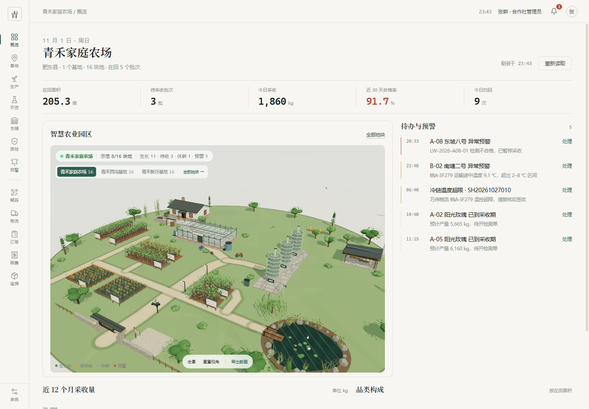
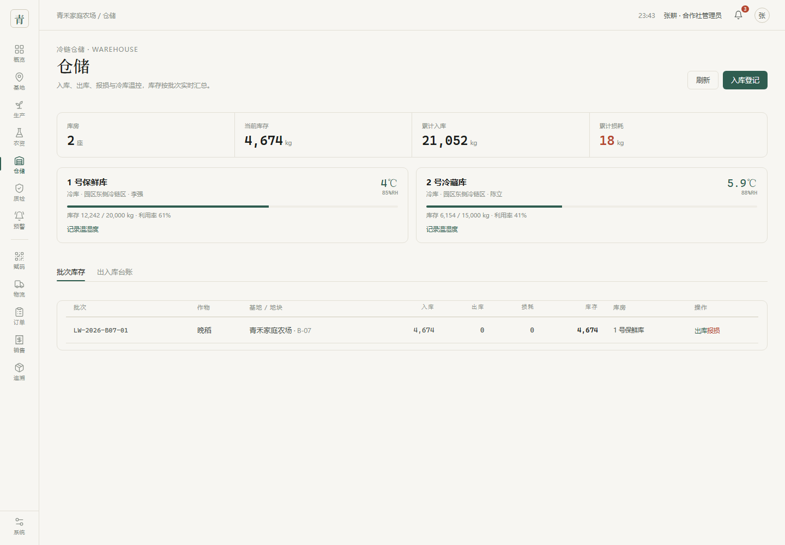
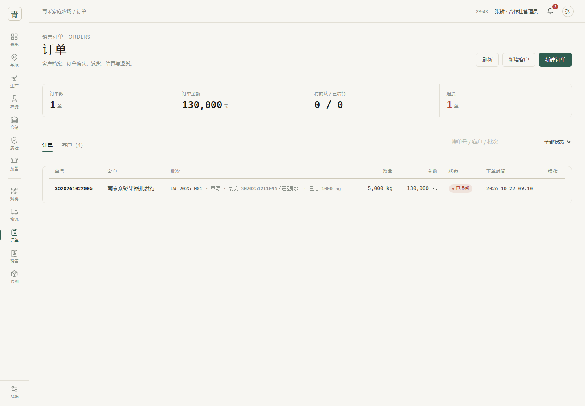
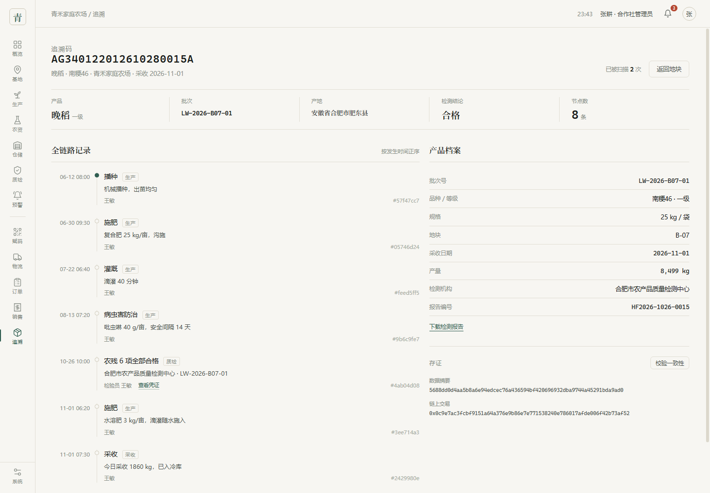
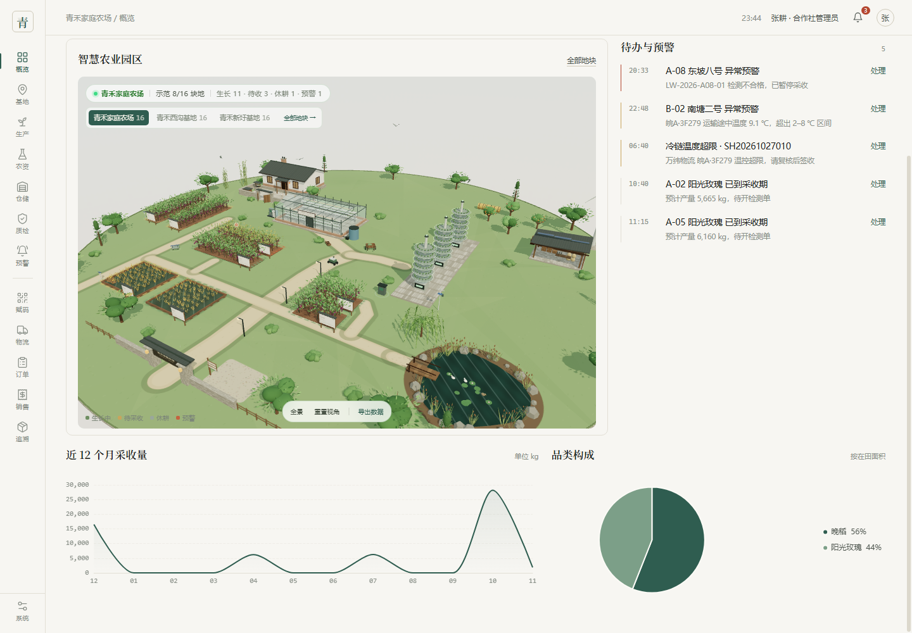

# 青禾智慧农业 · 农产品溯源系统

一套可直接运行的「农业生产 + 质检 + 赋码 + 仓储 + 销售物流 + 消费者溯源」全链路演示系统。

前端 Vue 3 + Vite，园区与地块使用 Three.js 展示；后端 Spring Boot 3 + MySQL 8。所有列表、统计、状态流转均来自真实数据库，不使用前端假数据。



---

## 一、功能概览

| 模块 | 说明 |
|---|---|
| 概览 | 3 个基地 / 48 块地 / 53 个批次的在田统计、今日采收、近 30 天合格率、今日扫码、待办预警、12 个月采收趋势、品类构成饼图 |
| 地块 | 地块台账、作物与批次、状态筛选、详情抽屉、地块与批次互查 |
| 生产 | 农事流水、环节筛选、新增农事；农资领用自动生成打药/施肥记录并写入安全间隔 |
| 质检 | 6 项农残检测、模板、检测报告上传/预览、复检、不合格处置、批次与地块锁定/恢复 |
| 赋码 | 码段生成、激活、作废、冻结/解冻、批量二维码、标签打印（PNG / PDF / 打印） |
| 仓储 | 2 个冷库、批次库存、出入库、报损、温湿度记录与超温通知 |
| 农资 | 农药/化肥采购、领用、库存与低库存提醒、安全间隔 |
| 物流 | 运输单、承运商/车牌、温度曲线、轨迹节点、签收；重复建单与重复签收拦截 |
| 订单/客户 | 客户档案、订单确认、发货、结算、退货；订单与物流单号联动 |
| 预警 | 待处理/处理中/已解除、认领、指派（限本农场成员）、解除；质检预警必须先复检或处置 |
| 通知 | 站内信/短信/企微模拟通道、未读计数、已读、超时升级 |
| 追溯 | 追溯码台账、扫码记录；全链路时间线来自农事、质检、仓储、物流与销售真实数据 |
| 消费者 | `/t/:code` 免登录 H5，真实写入扫码记录，展示产品档案、检测结论与时间线 |
| 系统 | 农场、用户角色、操作日志、账号设置、全局农场切换 |

更多界面：

| 仓储 | 订单 |
|---|---|
|  |  |

| 追溯时间线 | 品类饼图 |
|---|---|
|  |  |

---

## 二、技术栈

- **前端**：Vue 3.5、TypeScript、Vite 5、Vue Router、ECharts 5、Three.js 0.186、lucide-vue-next、qrcode、jsPDF
- **后端**：Java 17、Spring Boot 3.3.5、Spring JDBC、MySQL Connector/J、springdoc-openapi（Swagger UI）
- **数据库**：MySQL 8.0，库名 `agri_trace_app`
- **鉴权**：BCrypt 密码 + 内存 Session Token（重启后端后需重新登录）
- **文件**：检测报告保存在 `server/uploads/reports`，数据库只存 URL

---

## 三、目录结构

```text
agri-trace/
├─ README.md
├─ docs/screenshots/              # README 截图
├─ sql/
│  ├─ 01_schema.sql               # 建库建表（会 DROP agri_trace_app）
│  ├─ 02_seed.sql                 # 演示数据
│  ├─ 03_agri_trace_app_dump.sql  # 完整数据库备份（可直接导入）
│  └─ 04_shift_demo_dates.sql     # 把演示业务日期平移到运行当天（幂等）
├─ server/
│  ├─ pom.xml
│  ├─ src/main/java/...           # 控制器 / 服务 / 批次状态机
│  ├─ src/main/resources/application.yml
│  ├─ uploads/reports/            # 45 份演示检测报告
│  └─ target/agri-trace-server-0.1.0.jar  # 预编译后端
└─ web/
   ├─ src/                        # Vue 页面、组件、API
   ├─ public/
   ├─ .env.local                  # VITE_USE_MOCK=false
   ├─ package.json
   └─ vite.config.ts              # 5181，/api 代理到 8080
```

---

## 四、环境要求

| 软件 | 版本 | 是否必需 |
|---|---|---|
| JDK | 17（推荐 Temurin 17） | 必需 |
| MySQL | 8.0+ | 必需 |
| Node.js | 18+（建议 20/22 LTS） | 必需 |
| npm | 随 Node 安装 | 必需 |
| Maven | 3.9+ | 仅在需要从源码重新编译后端时需要 |

> 包内已包含后端 jar，正常情况下无需安装 Maven。
> Windows 下如果 `java -version` 不是 17，请先把 `JAVA_HOME` 指向 JDK 17。

---

## 五、快速启动

### 1. 初始化数据库

先启动 MySQL，确认 root 密码（下面示例为 `123456`，请按实际修改）。

**方式 A：建表 + 演示数据（推荐）**

```bash
cd agri-trace
mysql -uroot -p123456 < sql/01_schema.sql
mysql -uroot -p123456 < sql/02_seed.sql
mysql -uroot -p123456 < sql/04_shift_demo_dates.sql
```

**方式 B：直接导入完整备份**

```bash
mysql -uroot -p123456 < sql/03_agri_trace_app_dump.sql
mysql -uroot -p123456 < sql/04_shift_demo_dates.sql
```

> `01_schema.sql` / 完整备份都会先删除并重建 `agri_trace_app`，不会影响机器上其他数据库。
> 如果 MySQL 不在 PATH，Windows 下可使用完整路径，例如 `D:\mysql\bin\mysql.exe`。
> `04_shift_demo_dates.sql` 会把演示业务日期平移到运行当天，保证“今日采收 / 今日扫码”等指标有数据；同一天重复执行不会重复平移，跨天后可再次执行。

### 2. 启动后端

**方式 A：直接运行预编译 jar（推荐）**

```bash
cd agri-trace/server
java -jar target/agri-trace-server-0.1.0.jar
```

**方式 B：从源码编译**

```bash
cd agri-trace/server
mvn -DskipTests package
java -jar target/agri-trace-server-0.1.0.jar
```

后端地址：<http://127.0.0.1:8080>
Swagger UI：<http://127.0.0.1:8080/swagger-ui.html>

> 必须在 `server` 目录下启动，检测报告会按相对路径写入 `server/uploads/reports`。
> 数据库账号默认 `root / 123456`，可用环境变量覆盖：
>
> ```bash
> # Windows CMD
> set DB_USER=root
> set DB_PASSWORD=你的密码
> java -jar target/agri-trace-server-0.1.0.jar
>
> # PowerShell
> $env:DB_PASSWORD="你的密码"
> java -jar target/agri-trace-server-0.1.0.jar
> ```

### 3. 启动前端

```bash
cd agri-trace/web
npm install
npm run dev
```

前端地址：<http://127.0.0.1:5181>

`web/.env.local` 已配置 `VITE_USE_MOCK=false`，请求通过 Vite 代理到 `127.0.0.1:8080`，无需处理 CORS。

生产构建：

```bash
npm run build      # 输出到 web/dist
```

### 4. 登录

| 账号 | 密码 | 角色 | 所属基地 |
|---|---|---|---|
| `admin` | `123456` | 合作社管理员 | 青禾家庭农场 |
| `zhangsan` | `123456` | 农艺师 | 青禾家庭农场 |
| `lihui` | `123456` | 农艺师 | 青禾西沟基地 |
| `wangmin` | `123456` | 质检员 | 青禾家庭农场 |
| `chenli` | `123456` | 仓管 | 青禾新圩基地 |
| `zhoumin` | `123456` | 销售 | 青禾西沟基地 |

右上角头像菜单支持「账号设置」与「切换农场」。切换后概览、地块、生产、赋码、物流、订单等页面均按农场隔离。

---

## 六、演示数据规模

- 3 个基地、48 块地、53 个批次（含近 12 个月历史批次）
- 199 条农事记录、45 张检测单（含可预览 PDF）
- 45 个赋码批次、约 2500 枚追溯码
- 31 张运输单、31 条销售记录、1314 条扫码日志
- 2 个冷库、5 种农资、6 张销售订单、4 家客户
- 3 条预警（2 待处理 + 1 已解除）、5 条通知

演示数据基准日期为 **2026-11-01**。导入后执行 `04_shift_demo_dates.sql`，系统会把业务日期平移到运行当天，因此“今日采收 / 今日扫码 / 近 30 天合格率”等指标可直接演示；跨天后再次执行该脚本即可继续平移。

---

## 七、典型演示路径

### 1. 质检不合格闭环

1. 进入「质检」→ 新建检测单，某项农残填超限值 → 批次变为“预警锁定”、地块锁定，并生成预警与通知。
2. 直接解除预警会被拒绝，提示先复检或处置。
3. 对不合格检测单「发起复检」，填写合格值 → 预警自动解除、地块恢复、批次解锁。
4. 也可对不合格单执行「销毁 / 退回 / 降级」处置并留痕。

### 2. 订单 → 物流 → 批次

1. 「订单」创建订单 → 确认。
2. 未创建运输单时点“发货”会被拦截，页面提示“未建运输单”。
3. 在「物流」为该批次创建运输单后，再回订单发货；订单行会显示物流单号与物流状态。
4. 物流签收后订单可结算；退货会生成退货记录并显示已退数量。

### 3. 仓储与农资

1. 「仓储」登记入库/出库/报损，库存与台账实时一致；超库存出库被拦截。
2. 库房温度超出区间会生成仓储温控通知。
3. 「农资」采购入库、领用出库；领用会自动写入一条带安全间隔的农事记录。

### 4. 追溯与消费者扫码

1. 赋码页生成码段 → 激活 → 标签打印。
2. 扫描标签二维码（或打开 `/t/:code`）会真实写入扫码日志并累加扫码次数。
3. 冻结码段或作废码段后扫码会被拒绝。
4. 追溯详情时间线来自农事、质检、仓储台账、物流轨迹和销售记录，不使用硬编码节点。

> 手机扫码：开发环境二维码使用局域网地址（由 `/api/system/lan` 自动探测）。请确保手机与电脑同一 Wi-Fi，并允许 Windows 防火墙放行 5181 端口；也可在 `web/.env.local` 设置 `VITE_PUBLIC_ORIGIN=http://你的IP:5181`。仅监听 127.0.0.1 时手机无法访问。

---

## 八、配置说明

| 配置 | 位置 | 说明 |
|---|---|---|
| 端口 8080 | `server/src/main/resources/application.yml` | 后端端口 |
| 数据库连接 | 同上 `spring.datasource` | 默认 `127.0.0.1:3306/agri_trace_app` |
| `DB_USER` / `DB_PASSWORD` | 环境变量 | 覆盖数据库账号 |
| 上传目录 | `application.yml` 的 `app.upload-dir`，默认 `uploads` | 相对后端启动目录 |
| 端口 5181 | `web/vite.config.ts` | 固定端口，`strictPort` |
| `/api` 代理 | 同上 | 默认代理到 `127.0.0.1:8080` |
| `VITE_USE_MOCK` | `web/.env.local` | `false` 走真实接口；`true` 使用内置 Mock |
| `VITE_PUBLIC_ORIGIN` | `web/.env.local`（可选） | 标签二维码使用的外部访问地址 |

---

## 九、常见问题

**1. 后端启动报数据库连接失败**
确认 MySQL 已启动、库名是 `agri_trace_app`、`DB_USER/DB_PASSWORD` 正确；先执行第 5 节数据库初始化。

**2. 登录提示“账号或密码不正确”**
首次启动后端会把演示账号密码初始化为 `123456`。如果仍失败，重新导入 seed 或 dump。

**3. 重启后端后需要重新登录**
登录态保存在后端内存，重启即失效，这是演示版的预期行为。

**4. 检测报告 404**
后端必须在 `server` 目录启动；否则相对路径 `uploads` 会解析到错误位置。

**5. 前端 5181 被占用**
端口固定为 5181。释放端口或修改 `web/vite.config.ts` 的 `port`，同时调整 README 中的访问地址。

**6. npm install 很慢**
可切换镜像：`npm config set registry https://registry.npmmirror.com`。

**7. Windows 下 `mvn` 使用了 JDK 8**
把 `JAVA_HOME` 指向 JDK 17 后再执行 Maven。

**8. 手机扫码打不开**
确认前端使用 `--host 0.0.0.0`（本项目已配置）、手机与电脑同一网络、防火墙放行 5181；二维码中的地址应显示局域网 IP，而不是 `127.0.0.1`。

---

## 十、已知限制

- 短信、企微为模拟通道，不接真实服务商。
- 登录态保存在内存，后端重启后需重新登录。
- 检测报告保存在本地磁盘，未接对象存储。
- 演示数据时间为固定基准日，需执行 `04_shift_demo_dates.sql` 平移到运行当天；跨天后可再次执行。
- 标签二维码依赖当前访问地址，手机扫码需同一局域网。
- 订单发货要求先创建运输单，这是系统有意的业务联动约束。

---

## 十一、验证情况

交付前已完成系统级回归：

- 全系统 API：112 项通过（仓储、农资、质检、赋码、订单、通知、农场隔离、分页、写入传播）
- 全站页面：40 项通过，无 HTTP ≥ 400、无浏览器控制台错误
- P0 页面操作：33 项通过
- P1 扫码/报告/分页/采收：27 项通过
- 账号/农场切换：21 项通过

如需重新开始演示，停止后端 → 重新导入 `sql/01_schema.sql` + `sql/02_seed.sql` → 启动后端即可。
